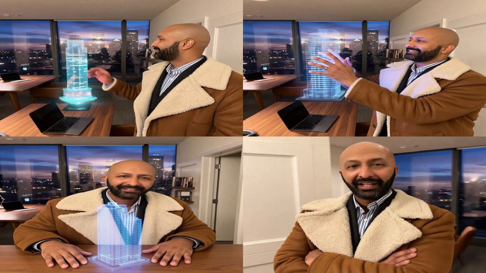
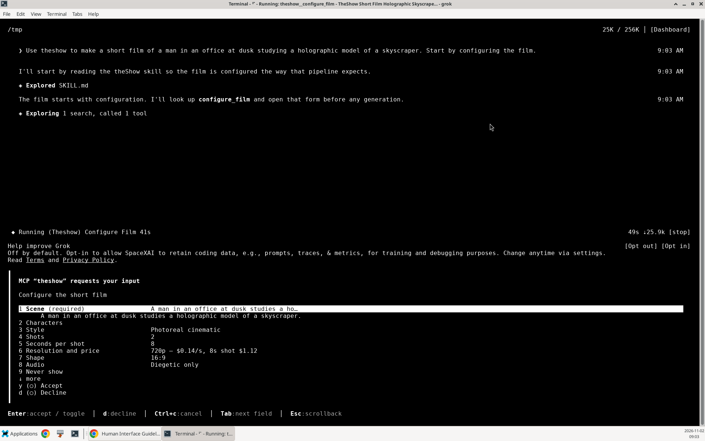

# theShow

**Continuity-first AI film generation, as a Grok plugin.**

Most AI video tools give you a slot machine. You type a sentence, you get eight seconds, and the next eight seconds has a different face, a different coat, and a different street.

theShow treats a film as a sequence of planned shots instead of one lucky prompt. It collects the whole brief before spending anything, boards the film as stills so you can see it before you buy it, pins each cut to a single shared frame so two shots meet on identical pixels, and assembles the result with FFmpeg.

It runs on your Grok subscription, so there is no separate API key to buy.

<!-- Hero: the proof film, four frames from one 24-second render. -->


**[Watch the full 24-second film](docs/media/tay-17th-floor-720p.mp4)** — 720p, 8.4 MB

---

## A real film, measured

That film was made end to end through the installed plugin: one form, one board, one chained render. It is the evidence behind every claim below.

| | |
|---|---|
| Job | `seq_mvzhmxbj_ahcsd9` |
| Shots | 4 × 6 seconds, 720p (1280×720), 24 fps, hard cuts |
| Result | 24.17 seconds, 580 frames, 8.4 MB |
| Cost | **$3.44** actual ($0.86 a shot) against a $3.36 quote |
| Warnings | none |

What was checked, on the rendered pixels rather than on the prompt:

- **Every shot landed on its pinned closing frame.** Correlation to the supplied last frame: 0.999, 0.999, 0.988, 0.980.
- **Every cut is seamless by construction.** Correlation across the three cuts: 0.9980, 0.9956, 0.9699 — at or above the within-shot controls for the same footage (0.9863, 0.8881). Two shots meeting on the same file cannot disagree.
- **The face held.** SFace identity against the reference portrait, sampled every half second across 47 detected faces: mean 0.519. Every score below 0.36 was inspected and is a pose, not a different person — a profile, a face leaving frame, a man turned away.
- **The wardrobe held.** Tan coat presence mean 0.684; navy, the garment the old prompt wrongly named, mean 0.008 (max 0.069).
- **The room held.** The left-window patch stayed put within shots that keep the same framing, and the board's frames agreed with each other at 0.843 mean structural correlation.

The numbers, the method and the raw measurements are in [`docs/proof.md`](docs/proof.md). The short version is that the picture was measured, not asserted.

---

## Install

```bash
grok plugin install TayDa64/theShow --trust
```

That is the whole setup. The server ships pre-bundled, so startup runs no `npm install` and needs no network.

Confirm the wiring:

```bash
grok mcp doctor
```

You want `theshow` reported healthy with **thirteen tools** discovered. Run that on the machine the session is actually using — plugins install per machine, and a Grok web sandbox is not your machine.

If the session's tool list has no `plan_storyboard`, the plugin is not loaded there. theShow's skill tells the model to stop and say so rather than quietly build a film some other way.

To update:

```bash
grok plugin uninstall theshow && grok plugin install TayDa64/theShow --trust
```

---

## Your first film

Ask in plain language. You never call the tools yourself.

> Use theShow to make a four-shot film of a man in a 17th-floor office at dusk, studying a holographic model of a skyline. Keep his face and his coat the same in every shot.

### It asks before it spends

`configure_film` puts the whole brief on one interactive card: scene, characters, style, shot count, seconds per shot, resolution and its price, aspect ratio, audio, what must never appear, a music or voiceover path, and an optional reference image. The card returns your answers as JSON plus a cost estimate, and renders nothing.



One card is one model turn. Asking the same questions one at a time spends a turn on each before a frame exists — and turns cost money on top of renders.

Two rules the tool holds to:

- **A blank stays blank.** Anything you leave empty is left out of the film, and the model is told never to invent a character detail you did not give. An invented detail is a second paid render.
- **Decline means no.** A declined or cancelled card comes back as an instruction not to render.

The reference field takes a **path or an https URL**, because MCP has no file upload. A photo attached in chat already arrives as a readable local path, so **on a phone you just attach the picture.** HEIC and HEIF are transcoded automatically and oversized images are stepped down until they fit; a 12-megapixel photo arrives around 190 KB. Never resize or convert your own photo.

### Slash commands

Nine commands ship with the plugin. Each one is the same workflow, started partway in.

| Command | What it does |
|---|---|
| `/film <idea>` | Opens the configuration card, then boards and renders the film |
| `/scene <scene> [shots]` | Plans a storyboard only. Free, renders nothing |
| `/character <name> [look] [photo]` | Creates or updates a character with reference photos |
| `/board <scene or jobId>` | Boards a film as stills, about two cents a frame |
| `/render <shots.json>` | Renders a planned shot list |
| `/check [jobId]` | Progress and real cost on a render, or your recent films |
| `/retry <jobId> <shot> [prompt]` | Re-renders one bad shot and splices it back |
| `/films [count]` | Lists films on disk. Free |
| `/resume <jobId> <what next>` | Continues an existing film with more shots |

None of them skips the estimate. A command that spends money still prices the work, shows you the figure, and waits for your yes.

### Board it before you buy it

Between the approved brief and the first paid render there is a cheap checkpoint: **`board_film`**. It generates one still per shot boundary, so you see the film as pictures first.

A still is **$0.02**. A second of 720p video is **$0.14**. A four-shot film boards as five stills for ten cents and renders for about $3.44 — the board is roughly 3% of the cost and catches the things that are expensive to fix later: wrong wardrobe, wrong light, a face that is not your character, a room that reads nothing like the one you meant.

- **N shots produce N+1 stills**, not 2N. The boundary between two shots is one picture, used as the first shot's last frame and the second shot's first frame. That is what makes the cut exact.
- **A reference photo outranks the prompt here.** The board edits from your picture rather than treating it as a hint, so the prompt's job is to change the pose and the action and leave the rest alone.
- **Re-running is free** for anything already on disk, so an interrupted board resumes instead of re-buying.

---

## The thirteen tools

| Tool | Costs | What it does |
|---|---|---|
| `configure_film` | free | Collects the whole brief on one card, with a cost estimate |
| `create_character` | free | Stores a named character with reference photos on disk |
| `plan_storyboard` | free | Turns a scene into numbered shots with framing and continuity notes |
| `board_film` | $0.02 a still | Boards a film as stills, one per shot boundary, so cuts land on identical pixels |
| `generate_still` | $0.02 | One image, for a frame you want on its own |
| `render_sequence` | per shot | Renders a whole shot list with frame-to-frame continuity, then assembles it |
| `check_sequence` | free | Progress and real cost on a running sequence |
| `retry_shot` | one shot | Re-renders a single bad shot and splices it back in, reusing the rest free |
| `list_films` | free | Films on disk with job ids, costs and paths, including earlier sessions |
| `generate_controlled_clip` | per shot | One clip, optionally bookended by a first and a last frame |
| `extract_last_frame` | free | Pulls the bridge frame out of a rendered clip |
| `assemble_film` | free | Joins ordered clips into one film with FFmpeg, hard cuts by default |
| `extend_clip` | per call | Continues an existing take. **API-key backends only** |

---

## How continuity actually works

A film is not one long generation. It is a chain, and the chain is the whole design.

**The boundary frame belongs to both shots.** A boarded film does not guess where one shot ends and the next begins: N shots produce N+1 stills, and shot 2's first frame is shot 1's last frame, byte for byte. Every cut is between two uses of the same file.

**Pinning changes the deal.** A clip pinned only at its start drifts: two unpinned clips of the same scene sit around 0.20 correlation, which is why a cut between them pops. Pinning both ends pins the opening frame at 0.998 against the supplied image and the closing frame at 0.87 — lower only because the last rendered frame carries motion blur. Shot 1's last frame and shot 2's first frame are the same picture, so there is nothing to hide with a fade.

**A location is the subject, not the setting.** When the cast includes a character whose role is `Location`, its photo becomes the base that every frame is edited from, and the board spends one extra still — two cents — building a hero frame of the cast inside that room first. Measured skyline agreement across a five-frame board: **0.72** by that route, against 0.57 editing from the location alone, 0.36 chaining, and 0.25 when a portrait rode along as a second reference. A face has a portrait pinned on every frame to correct it; a redrawn room has nothing.

**The cast line describes the photo, never argues with it.** A measured board whose cast line said "navy blazer" while the portrait showed a tan sherpa coat produced a different jacket in three of five frames — the prompt was arguing with the picture. Once the line described the coat that is in the photo, the same board held it in all five. Garment agreement rose from 0.51 to 0.64. `mcp/cast.ts` now enforces that: a cast line naming a garment the picture contradicts is rewritten.

**Cuts are planned, not hidden.** Chained generations drift in fine texture, so any join between near-identical framings shows it — a dissolve double-exposes both patterns, a hard cut pops. Neither is a fix. The real fix is to change the framing between shots, and that is why the storyboard varies shot type and camera move per shot.

**A film survives the session.** Every job is written to `~/.theshow/jobs` as it renders and reloaded at startup, with the footage in `~/.theshow/media`. A film can be continued, repaired or re-assembled days later, and `list_films` is how you find it.

---

## Cost

Every render is a real charge, and **resolution sets the price**. Measured on real eight-second renders:

| Resolution | Output | Per second | 8-second shot | 4-shot film |
|---|---|---|---|---|
| `480p` | 848×480 | $0.08 | $0.64 | $2.56 |
| `720p` | 1280×720 | $0.14 | $1.12 | $4.48 |
| `1080p` | 1920×1088 | $0.25 | $2.00 | $8.00 |

- **A still is $0.02**, measured. Board first when the look matters: five stills for a four-shot film is ten cents against $3.44 of footage.
- **The default is 720p.** Leaving resolution unset does not mean 480p pricing — the API returns a soft 848×480 frame for it, so the old flat "eight cents a second" figure was quoting the cheapest, worst-looking setting and made every estimate a third too low. Always name the resolution beside a price.
- **One shot runs to 15 seconds.** Nothing caps a film except patience and budget; 12 shots at 8 seconds is 96 seconds, and two continued runs pass three minutes.
- **Every render returns its actual `costUsd`.** Quote that, not the estimate. Failed renders are not billed.

---

## Authentication

`render_sequence`, `generate_controlled_clip`, `board_film` and the rest resolve a credential in this order:

1. **`XAI_API_KEY`**, if genuinely set — billed as xAI API credits at `https://api.x.ai`.
2. **Grok subscription session** — read from `~/.grok/auth.json` after `grok login`. No API key required. This is the normal path, and the one the proof film ran on.

An unset MCP environment variable can arrive as a literal `${XAI_API_KEY}` string, so theShow treats that shape as absent rather than sending it as a bearer token. An expired token reports a reason that names `grok login`.

`extend_clip` needs the API key: the subscription proxy answers `POST /v1/videos/extensions` with **HTTP 405**. On a subscription, continue a shot with `generate_controlled_clip` and `firstFrameUrl` instead. The tool says this plainly rather than retrying.

---

## Limits and known edges

- **`firstFrameUrl` must be an image.** A clip there returns `invalid_image`.
- **`first_frame` is silently ignored** by the underlying API — a shot sent with it landed at 0.14 correlation against the supplied image, same as an unpinned render. It fails without saying so. theShow sends `image` on the wire, which is what `firstFrameUrl` does for you. `last_frame` works.
- **A shot is at most 15 seconds.** For longer, chain shots or resume a job.
- **Rate limits exist** on the generation endpoints. Space calls out; theShow reports the real error rather than silently switching backends.
- **`retry_shot` cannot repair the seam after the repair.** Shots after the new one were built from the original shot's last frame, so that next join becomes a cut. The tool says so in `warnings` every time.
- **A film caught mid-render when the server stopped** returns as `state: "stopped"`. Every shot it had already finished is still on disk and still paid for — assemble them, or continue from the last one.
- **No garment check.** A colour check was built and removed: it learned the coat from the hero frame's arms, the hero is cropped at the chest, and it quietly abstained on every frame of a real board. What holds the wardrobe is the cast line, plus your own eyes on a board that costs pennies. This README would rather say that than imply a safeguard that does not exist.

---

## StoryForge Studio

The plugin is the fast path. The repository also contains **StoryForge Studio**, the web workspace the pipeline grew out of: a character roster, scene library, storyboard editor, timeline, and export panel.

```bash
npm install
npm run dev          # http://localhost:3000
```

The workspace loads in local draft mode with no account. **Live video routes require a signed-in local account.** The header line shows the account's provider mode, or local draft mode when signed out, and the export panel names the video backend in use.

Optional environment for the Studio (`GEMINI_API_KEY` for the Veo path, `SESSION_SECRET`, `STORYFORGE_ENCRYPTION_KEY`, and the `GOOGLE_OIDC_*` set for Google sign-in) is documented in [`.env.example`](.env.example). StoryForge keeps **app login** separate from **provider credentials**; a personal Gemini key connected in the Account dashboard is stored server-side and encrypted at rest.

The Studio prefers Grok when a credential resolves and falls back to Gemini Veo, via `GEMINI_API_KEY` or a key on the account, when it does not.

---

## Developing

```bash
npm run build:mcp    # bundle mcp/server.ts → mcp/server.bundle.mjs (committed)
npm test             # 174 tests across 15 files
npm run typecheck
npm run lint
```

`mcp/server.bundle.mjs` is committed on purpose: an install must never run `npm install`. After changing anything under `mcp/`, rebuild the bundle and commit it, or the plugin will keep running the old code.

```
mcp/          the MCP server and its continuity logic
  server.ts     tool definitions
  storyboard.ts board planning and still generation
  cast.ts       cast-line reconciliation against the reference photo
  grokVideo.ts  the video and image API client
  characters.ts the on-disk character store
skills/theshow/ the workflow the model follows
commands/       the nine slash commands
docs/           install guide and proof images
src/            StoryForge Studio (React + Express)
tests/          vitest
```

---

## Where this goes next

The interesting problems left are continuity problems: holding a location, a light source, or a prop across a cut, and doing it without charging for the same shot twice.

If you build something with it, that is where the tool earns its keep.

Built by [@TayDa64](https://github.com/TayDa64).
