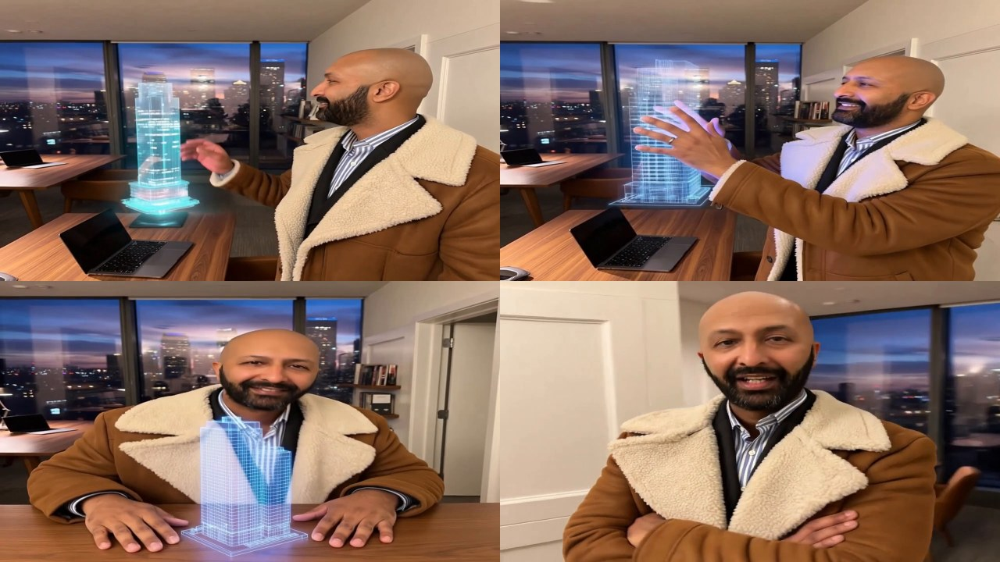

# theShow

theShow is continuity-first AI film production. It is a Grok plugin (an MCP server with eighteen tools) plus **theShow Studio**, the visual workspace in this repository.

You describe a film once. The plugin prices the work before it spends, boards stills, pins frames, and assembles the clips with FFmpeg. Studio is where you watch and edit. Production still finishes if neither Studio nor a Grok Bot is running.

## Demo

<!-- DEMO_VIDEO_URL: Eshetie to paste user-attachments URL here -->

45-second landscape ad (720p, 1280×720). GitHub plays a README video only from a `https://github.com/user-attachments/assets/…` URL, which Eshetie pastes on the line above. This placeholder is the only blocker. The current ad is used as-is, including the contract beat that still shows Veo and Gemini on screen.

<!-- TODO: poster path. A poster JPG is not in the repo. When that still exists, link it here to the user-attachments URL above so viewers that do not render the player still get the hero frame. -->

Poster fallback: TODO. The poster JPG is not in this repo, so this line is not an image link yet. Point it at the user-attachments URL above once the file exists.

The proof film is a separate 24-second render. GitHub does not play a repo-relative video, so the frames below are the in-page view. Measurements, including the **$3.44** cost (4 × $0.86), are in [`docs/proof.md`](docs/proof.md).

[](docs/proof.md)

## Quick start

### Plugin

```bash
grok plugin install TayDa64/theShow --trust
grok mcp doctor
```

`grok mcp doctor` should report `theshow` healthy with **eighteen tools**. Plugins install per machine. Update with `grok plugin uninstall theshow && grok plugin install TayDa64/theShow --trust`.

### Studio

Node 22.

```bash
npm ci
cp .env.example .env
THESHOW_VIDEO_BACKEND=sandbox npm run dev
```

Open `http://localhost:3000`. The server reads **`.env`**, not `.env.local` (`dotenv.config()` in `server.ts`). `PORT` defaults to **3000**. `THESHOW_VIDEO_BACKEND=sandbox` is the mock preview and makes no paid call.

Deeper install, HTTP transport, continuity, and limits: [`docs/reference.md`](docs/reference.md).

## Architecture

| Piece | Role |
|---|---|
| theShow Studio (`src/`, `server.ts`) | Visual source of truth for the edit |
| MCP tools and `~/.theshow` | Authoritative production control (`jobs`, `media`, `characters`) |
| Production feed and the event log | Read-only observers |
| Grok and Grok Bot | Observe and advise only |
| Recovery | A film finishes and reloads with no Bot and no Studio |

The job file under `~/.theshow/jobs` stays authoritative. `mcp/jobEvents.ts` appends a best-effort log at `JOBS_DIR/.events/<jobId>.jsonl`, capped at 2,000 events or 1 MiB. A failure there does not stop a render.

## MCP tools

These eighteen names are the tools registered in `mcp/server.ts`. A test compares this table to that file.

| Tool | Costs | What it does |
|---|---|---|
| `configure_film` | free | Collects the whole brief on one card, with a cost estimate |
| `create_character` | free | Stores a named character with reference photos on disk |
| `plan_storyboard` | free | Turns a scene into numbered shots, with wardrobe checklists and a per-room prop ledger |
| `generate_controlled_clip` | per shot, after `confirm` | One clip. `pin` defaults to `start`. An end-frame pin has to be asked for |
| `extend_clip` | per call, API key only | Continues an existing take. `confirm` spends only with `overrideValidation` |
| `extract_last_frame` | free | Pulls the last frame out of a clip as a PNG |
| `generate_still` | $0.02, after `confirm` | One image |
| `assemble_film` | free | Joins ordered clips into one film with FFmpeg |
| `render_sequence` | per shot, after `confirm` | Renders a shot list with continuity, then can assemble it |
| `board_film` | $0.02 a still, after `confirm` | Boards a film as stills, one per shot boundary |
| `retry_shot` | one shot, after `confirm` | Re-renders a single bad shot and splices it back in |
| `list_films` | free | Films on disk, including earlier sessions |
| `check_sequence` | free | Progress and real cost on a `render_sequence` job |
| `review_continuity` | free | Evidence review of each cut. It does not render or spend |
| `propose_repair` | free | Repair options with a price, what they fix, and what stays broken. It does not render |
| `suggest_coverage` | free | Coverage, pacing, and ladder notes for a plan or a film. It does not render or spend |
| `check_cross_film` | free | Read-only comparison of 2–20 films. It does not render, spend, or write a job. `persist: true` writes one report outside the jobs directory and lists that path in `mutatedPaths` |
| `production_feed` | free | Read-only feed of job transitions. It renders nothing, spends nothing, writes nothing, and is never required for production |

`confirm` omitted or false is a free estimate. A paid render needs `confirm: true`. Eleven slash commands ship with the plugin. `/theshow` starts a film. `/advisor` is free and does not render. The full command list, the workflow, and the continuity ledger are in [`docs/reference.md`](docs/reference.md).

## Backends and costs

`resolveVideoBackend` in `src/lib/grokClipStore.ts` chooses the engine in this order:

1. `THESHOW_VIDEO_BACKEND` when it is `grok`, `gemini`, or `sandbox`. Any other value except `auto` is ignored, with a warning.
2. A Vitest run, or `NODE_ENV=test`, never selects `grok`. It uses `gemini` only when a workspace or personal key is connected, otherwise `sandbox`.
3. A resolved Grok credential: `XAI_API_KEY`, then `~/.grok/auth.json`.
4. `gemini`, only when a workspace or personal key exists.
5. `sandbox`.

An unpinned live render whose choice is `sandbox` and that has no Gemini provider returns **HTTP 503** with code `no-video-backend`. It does not quietly hand back a mock clip. Set `THESHOW_VIDEO_BACKEND=sandbox` when you want mock previews.

What a backend bills:

| Backend | Bills |
|---|---|
| `grok` with `XAI_API_KEY` | xAI API credits |
| `grok` with the CLI session | The Grok subscription |
| `gemini` | Gemini API quota |
| `sandbox` | Nothing. Mock preview |

Video rates in `mcp/server.ts` (the configure card): 480p is $0.08/s ($0.64 for 8 seconds), 720p is $0.14/s ($1.12), 1080p is $0.25/s ($2.00). A still is $0.02 after `confirm`. The proof film in [`docs/proof.md`](docs/proof.md) cost **$3.44**. Quote `costUsd` from the tool result, not the estimate. Tests must set `THESHOW_VIDEO_BACKEND=sandbox` and must not call Grok, Veo, or Gemini.

## Production feed

`GET /api/production/feed` answers a loopback peer only. Studio may listen on `0.0.0.0`; the route still returns 404 for anyone else. `THESHOW_STUDIO_FEED=0` turns the route off (404). The route reads `JOBS_DIR/.events/<jobId>.jsonl` and never writes `~/.theshow`. The `production_feed` tool does the same read. Details: [`docs/production-feed.md`](docs/production-feed.md).

## Testing and CI

```bash
npm run typecheck
npm run lint
npm test
npm run test:e2e
npm run build
npm run build:mcp
```

`npm test` is Vitest, including `tests/e2e-bundles.test.ts`. It does not call xAI. `npm run test:e2e` is Playwright on `studio-dev` (port 3100, the dev server) and `studio-built` (port 3101, the built server). Both pin `THESHOW_VIDEO_BACKEND=sandbox`.

Specs:

- `e2e/studio-baseline.spec.ts` — surfaces, plus axe WCAG 2.2 AA
- `e2e/production-feed.spec.ts`
- `e2e/timeline-shell.spec.ts`
- `e2e/branding.spec.ts`
- `e2e/display-name.spec.ts`
- `playwright/lion-greeting-workflow.spec.ts`
- `playwright/sandbox-guard.spec.ts`

`playwright/lion-greeting-live.spec.ts` runs only when `RUN_LIVE_VEO=1`. That path is paid. CI's `e2e` job fails if `RUN_LIVE_VEO` is set.

`.github/workflows/ci.yml` defines these jobs. This README does not claim they are branch-protection required checks.

| Job | What it runs |
|---|---|
| `typecheck` | `npm run typecheck` |
| `lint` | `npm run lint` |
| `build` | `npm run build`, then checks `dist/assets` for `GEMINI_API_KEY` |
| `test` | `npm test`, with paid keys refused and `GROK_AUTH_FILE` pointed at a missing file |
| `bundle` | `npm run build:mcp`, then `git diff --exit-code` on both bundles |
| `e2e` | Playwright, sandbox pin, same paid-key refusals |
| `all-green` | waits for the six jobs above |

## Status and roadmap

Merged:

- Phase 1, evidence review and cost gates: [PR #12](https://github.com/TayDa64/theShow/pull/12). Issue [#11](https://github.com/TayDa64/theShow/issues/11) is still open.
- Phase 2, advisory coverage and cross-film checks: [PR #15](https://github.com/TayDa64/theShow/pull/15). Issue [#14](https://github.com/TayDa64/theShow/issues/14) is still open.
- Pre-Phase 3, bundle e2e, Studio axe, CI e2e: [PR #17](https://github.com/TayDa64/theShow/pull/17). Issue [#16](https://github.com/TayDa64/theShow/issues/16) is still open.
- Phase 3, job event log and production feed: [PR #19](https://github.com/TayDa64/theShow/pull/19).

Open follow-ups, not closed by those merges: [#13](https://github.com/TayDa64/theShow/issues/13), [#21](https://github.com/TayDa64/theShow/issues/21). Branding is [#22](https://github.com/TayDa64/theShow/issues/22) and draft [PR #23](https://github.com/TayDa64/theShow/pull/23). The community install article is [PR #5](https://github.com/TayDa64/theShow/pull/5). This README's accuracy pass is [#24](https://github.com/TayDa64/theShow/issues/24).

## Contributing

Open draft pull requests. Eshetie approves every merge. After any change under `mcp/`, run `npm run build:mcp` and commit both bundles. Tests stay on `THESHOW_VIDEO_BACKEND=sandbox`. Do not make a paid Grok, Veo, or Gemini call from a test.

## License

MIT. See [LICENSE](LICENSE).

brought 2 you by TayDa64 from Liku Labs
