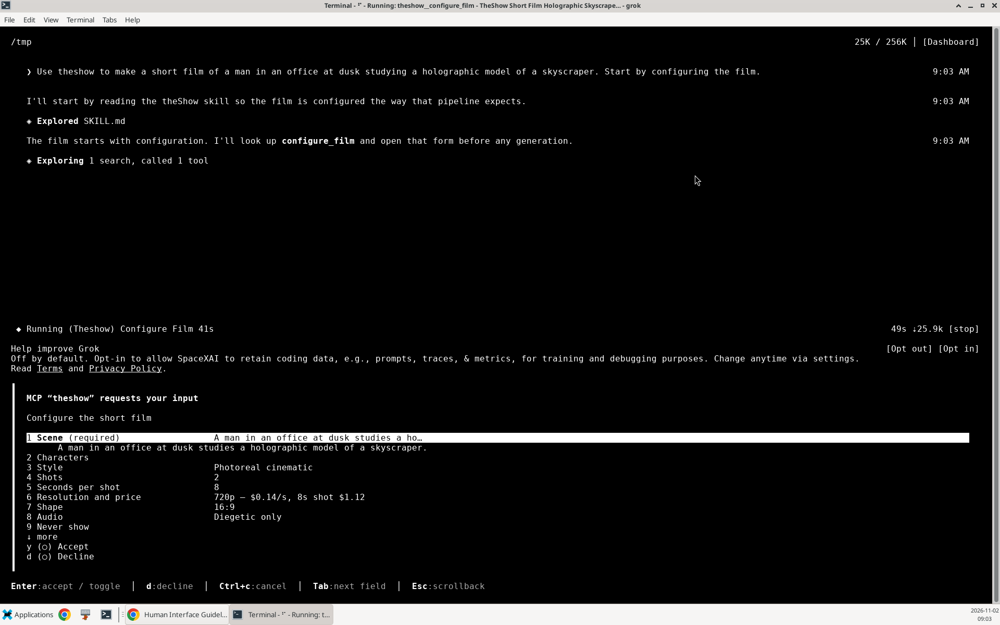
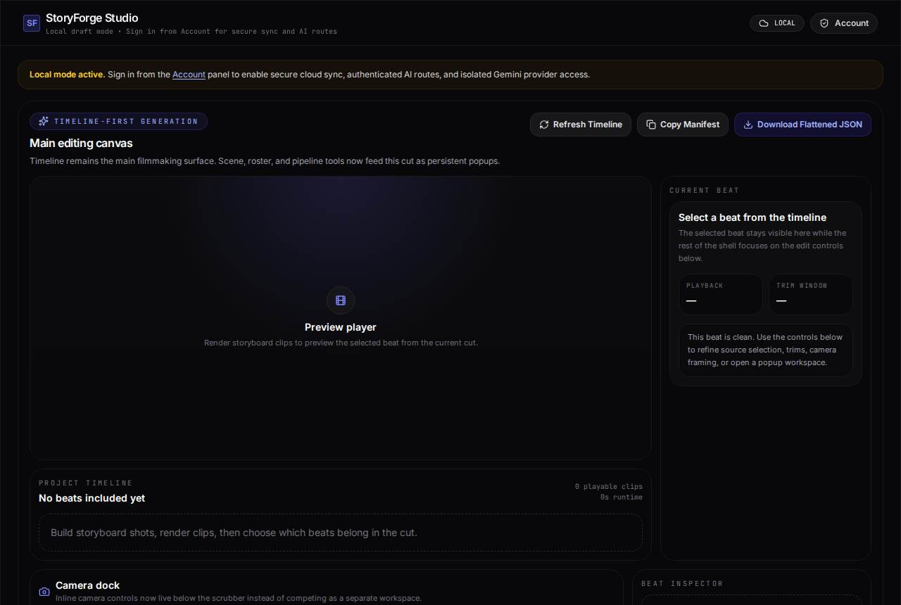
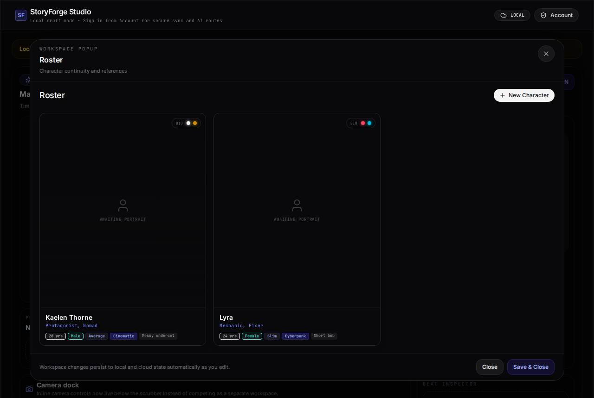
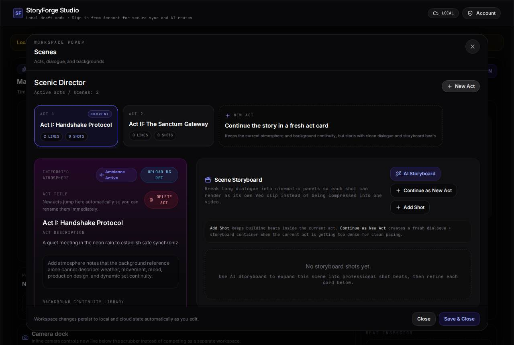
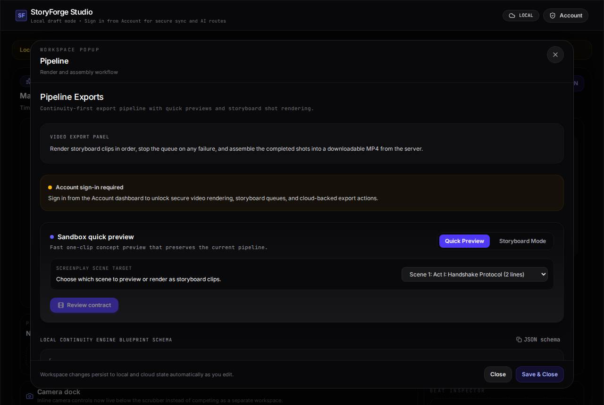

# theShow reference

Detail that used to live in the README. The short map is [README.md](../README.md). Prices below are the ones in `mcp/server.ts` or [`proof.md`](proof.md).

## Proof film

Job `seq_mvzhmxbj_ahcsd9`. Four shots of 6 seconds, 720p (1280×720), 24 fps, hard cuts. Result: 24.17 seconds, 580 frames, 8.4 MB. Cost **$3.44** actual ($0.86 a shot) against a $3.36 quote. No warnings. Pixel measurements (closing-frame match, cut correlation, SFace, wardrobe, room) are in [`proof.md`](proof.md).

The master is `docs/media/tay-17th-floor-720p.mp4`. GitHub's file viewer will not play a file that size. `docs/media/tay-17th-floor-preview.mp4` is the same film re-encoded to 960×540. GitHub does not play a repo-relative `<video>` in the README. The frames image in the README links here.

That film pinned both ends of each shot. The current default pin is `start`.

## Install

### Grok plugin

```bash
grok plugin install TayDa64/theShow --trust
grok mcp doctor
```

You want `theshow` reported healthy with eighteen tools discovered. Run that on the machine the session is actually using. A Grok web sandbox is not your machine.

If the session's tool list has no `plan_storyboard`, the plugin is not loaded there. The skill tells the model to stop and say so rather than quietly build a film some other way.

```bash
grok plugin uninstall theshow && grok plugin install TayDa64/theShow --trust
```

The server ships pre-bundled, so startup runs no `npm install` and needs no network. `.mcp.json` runs `node mcp/launch.mjs` and does not set `THESHOW_TRANSPORT`, so the desktop launch is stdio and opens no port.

### Desktop stdio from a checkout

```bash
node mcp/launch.mjs
```

Set `THESHOW_MCP_FROM_SOURCE=1` to run `mcp/stdio-main.ts` through `tsx` instead of `mcp/server.bundle.mjs`. That needs `node_modules`.

### Streamable HTTP

A second process exposes the same eighteen tools over Streamable HTTP. Tool names, input schemas, and handlers are the ones the desktop server uses. The process refuses to start without a bearer token, and the default bind is loopback.

```bash
THESHOW_TRANSPORT=http \
THESHOW_HTTP_TOKEN="$(openssl rand -hex 32)" \
THESHOW_HTTP_HOST=127.0.0.1 \
THESHOW_HTTP_PORT=8787 \
node mcp/launch.mjs
```

| Variable | Required | Default | What it does |
|---|---|---|---|
| `THESHOW_TRANSPORT` | no | `stdio` | `stdio` or `http`. Unset is stdio. |
| `THESHOW_HTTP_TOKEN` | yes, in http mode | none | Bearer token. The process exits if this is missing or blank when transport is `http`. |
| `THESHOW_HTTP_HOST` | no | `127.0.0.1` | Bind address. Anything other than loopback is refused unless `THESHOW_HTTP_EXPOSE=1`. |
| `THESHOW_HTTP_PORT` | no | `8787` | Bind port. `0` asks the OS for a free port. |
| `THESHOW_HTTP_EXPOSE` | no | off | Set to `1` before binding a non-loopback host. Put TLS in front of that listener. |
| `THESHOW_HTTP_ALLOW_GROK_SESSION` | no | off | HTTP bills `XAI_API_KEY`. Set to `1` to use `~/.grok/auth.json`, which spends the Grok subscription of the account in that file. |
| `THESHOW_HTTP_ALLOWED_HOSTS` | no | the bound host, `127.0.0.1`, and `localhost`, with the port | Extra `Host` values accepted when DNS-rebinding protection is on. |
| `THESHOW_HTTP_ALLOWED_ORIGINS` | no | `http://127.0.0.1:<port>` and `http://localhost:<port>` | `Origin` values a browser may send. Any other `Origin` is rejected. |
| `THESHOW_HTTP_SESSION_TTL_MS` | no | `1800000` | Idle session lifetime. |
| `THESHOW_HTTP_MAX_SESSIONS` | no | `32` | Cap. The oldest idle session is closed to make room. |
| `THESHOW_JOB_LEASE_MS` | no | `30000` | How long a running film may go without a heartbeat before another process may mark it stopped. |
| `THESHOW_JOB_HEARTBEAT_MS` | no | `10000` | How often the process that owns a render rewrites that heartbeat. |

The endpoint is `http://127.0.0.1:8787/mcp`. Every request needs `Authorization: Bearer <token>`. A missing or wrong token is rejected before any tool runs. `initialize` returns an `Mcp-Session-Id` header; send that header, and `MCP-Protocol-Version`, on later requests. `DELETE` the same URL with those headers closes the session. A dropped connection does not cancel a film. The process that started the render keeps a heartbeat on the job file under `~/.theshow/jobs`. Another process, stdio or HTTP, can see that film and will not mark it stopped while the heartbeat is fresh and the owner process is alive. A heartbeat dated more than five seconds in the future is ignored when the owner is on this machine. An owner on a different machine is allowed a minute of clock skew before a future stamp is treated the same way.

HTTP tool results leave out the `auth` field. Desktop stdio includes `auth` as `XAI_API_KEY` or `Grok CLI session`, and that string does not contain an email address. Desktop stdio still tries the API key first, then the subscription session.

`configure_film` returns the form fields as `needsInput` when the HTTP client has no GET stream to receive elicitation. A client that does open the stream gets the form, and on HTTP a missing answer comes back after `THESHOW_ELICIT_TIMEOUT_MS` (default 10 seconds). Desktop stdio waits for the form with no timeout.

The desktop bundle is `mcp/server.bundle.mjs` (`mcp/stdio-main.ts`). HTTP is `mcp/server-http.bundle.mjs` (`mcp/http-server.ts`). `node mcp/launch.mjs` picks from `THESHOW_TRANSPORT`. Importing `mcp/server.ts` does not listen and does not start stdio. The stdio bundle does not include the Hono HTTP stack.

The server answers POSTs with JSON. The client still has to send both accepted types:

```bash
curl -sS -D - http://127.0.0.1:8787/mcp \
  -H "Authorization: Bearer $THESHOW_HTTP_TOKEN" \
  -H "Content-Type: application/json" \
  -H "Accept: application/json, text/event-stream" \
  -d '{"jsonrpc":"2.0","id":1,"method":"initialize","params":{"protocolVersion":"2025-11-25","capabilities":{},"clientInfo":{"name":"curl","version":"0"}}}'
```

To reach it from Grok Chat, keep this process on `127.0.0.1` and put TLS in front of it. This process does not terminate TLS and does not serve rendered media over HTTPS. Point the connector at the public `https` URL of `/mcp`, and send the bearer token in a header. Do not put the token in the URL.

```json
{
  "mcpServers": {
    "theshow": {
      "url": "https://your-host.example/mcp",
      "headers": {
        "Authorization": "Bearer YOUR_TOKEN"
      }
    }
  }
}
```

## Your first film

Ask in plain language. You never call the tools yourself.

> Use theShow to make a four-shot film of a man in a 17th-floor office at dusk, studying a holographic model of a skyline. Keep his face and his coat the same in every shot.

`configure_film` puts the whole brief on one interactive card: scene, characters, style, shot count, seconds per shot, resolution and its price, aspect ratio, audio, what must never appear, a music or voiceover path, and an optional reference image. The card returns your answers as JSON plus a cost estimate, and renders nothing.



One card is one model turn. Asking the same questions one at a time spends a turn on each before a frame exists.

Two rules the tool holds to:

- **A blank stays blank.** Anything you leave empty is left out of the film, and the model is told never to invent a character detail you did not give.
- **Decline means no.** A declined or cancelled card comes back as an instruction not to render.

The reference field takes a **path or an https URL**, because MCP has no file upload. A photo attached in chat already arrives as a readable local path. HEIC and HEIF are transcoded automatically and oversized images are stepped down until they fit.

### Slash commands

Eleven commands ship with the plugin. `/theshow` is the primary start. `/film` follows the same recipe. `/advisor` is free and does not render.

| Command | What it does |
|---|---|
| `/theshow <idea>` | Primary start. The model calls `configure_film`, then the board, then the render contract |
| `/film <idea>` | The same recipe as `/theshow` |
| `/scene <scene> [shots]` | Plans a storyboard only. Free, renders nothing |
| `/character <name> [look] [photo]` | Creates or updates a character with reference photos |
| `/board <scene or jobId>` | Boards a film as stills, about two cents a frame |
| `/render <shots.json>` | Renders a planned shot list |
| `/check [jobId]` | Progress and real cost on a render, or your recent films |
| `/retry <jobId> <shot> [prompt]` | Re-renders one bad shot and splices it back |
| `/films [count]` | Lists films on disk. Free |
| `/continue <jobId> <what next>` | Continues an existing film with more shots |
| `/advisor <scene, jobId, or character>` | Free notes on a plan, one film, or several films. Does not render |

A command that spends money still prices the work and waits for a yes. The command files are in [`commands/`](../commands/theshow.md).

## The film workflow

1. **Configure.** `configure_film` collects the brief and a cost estimate. It spends nothing.
2. **Plan.** `plan_storyboard` turns the scene into numbered shots. Omit `promptStyle`, or pass `legacy`, for the paragraph prompt. `sections-v2` is opt-in: it writes a sectioned prompt and does not append the ledger paragraph. Planning is free.
3. **Board stills.** `board_film` generates one still per shot boundary. Call it without `confirm` for the estimate. Pass `confirm` only after a yes. Frames already on disk are reused and cost nothing.
4. **Render gates and the contract.** Before a paid video call, the server builds one contract per shot from the continuity ledger: the state at the start, the steps in between, the state at the end, invariants, and things that must not appear. Validation refuses more than three steps, a garment that is both worn and hanging, a count that invents a second coat or a third shoe, and a shot whose start does not match the previous shot's end. `confirm` does not unblock a failed board or a failed render. `overrideValidation: true` is the explicit bypass. A prompt lint also rejects forbidden nouns and negation before any paid call, because the image API has no negative-prompt field. `extend_clip` has no ledger, so `confirm` spends on an extension only when `overrideValidation` is set.
5. **Render.** `render_sequence` prices the shot list without `confirm` and spends only after `confirm`. It returns a `jobId`. Poll `check_sequence`. A long sequence keeps running, so do not call `render_sequence` again to check on it.
6. **Assemble.** `render_sequence` can assemble the finished shots. `assemble_film` joins an ordered list of clips with FFmpeg. A chained shot (its opening frame is the previous shot's extracted frame) is an exact frame join: the outgoing clip plays through that frame and the incoming clip's first frame is dropped. There is no dissolve on that join. A board-matched pair, where one shot's `lastFrameUrl` is the next shot's `firstFrameUrl`, is the same kind of join. Anything else uses `fadeDuration`. The MCP default is 0, a hard cut. Studio uses a 0.25 s crossfade. Omit `clips[].join` and the join is `auto`: the chain frame is detected locally from the last 12 frames, which does not call a model. Pass `clips[].join` as `chain`, `board-match`, `cut`, or `crossfade` to override that. `clips[].chainFrameIndex` is the 0-based source frame in that clip that the next clip was rendered from. The result includes `joins[]` with `requested`, `applied`, and, when a crossfade could not be built, `reason`. A music bed shorter than the film is refused. It is not looped.

`extract_last_frame` returns the true last frame, plus `frameIndex` and `framePts`. A user trim on a chained shot breaks the exact join and the timeline says "Chain broken by trim". An automatic pacing trim does not.
7. **Retry.** `retry_shot` re-renders one shot of a finished film and splices it back. The other shots stay as they were. The seam after the repaired shot is a cut, and the tool says so in `warnings`. `propose_repair` lists cheaper and wider options first and does not render them.
8. **Review.** `review_continuity` classifies each cut as measured, visually flagged, or unverified. It does not render or delete anything.
9. **Advise.** `suggest_coverage` reads a plan, or a film already on disk, and suggests coverage, pacing, and ladder-order notes. `check_cross_film` compares two to twenty films. Both are free. Neither renders, spends, or approves. A note that would need a new shot names `render_sequence`, `board_film`, or `retry_shot`, and that tool still returns its own price and waits for its own approval. `check_cross_film` with `persist: true` writes one report outside the jobs directory and lists that path in `mutatedPaths`. Without `persist`, `mutatedPaths` is empty.

## How continuity actually works

**The board shares a picture at each cut.** N shots produce N+1 stills. The boundary between two shots is one picture. `render_sequence` sends that closing frame only when `pin` is `"both"`. The default pin is `start`, so the cut is not pixel-pinned unless you ask. A start pin holds the opening frame. The proof film used both ends, which is why its cuts met on one file.

**A location can be the base image.** When the cast includes a character whose role is `Location`, its photo becomes the base that frames are edited from. [`skills/theshow/SKILL.md`](../skills/theshow/SKILL.md) records measured skyline agreement across a five-frame board: **0.72** by that route, against 0.57 editing from the location alone, 0.36 chaining, and 0.25 when a portrait rode along as a second reference. The proof film's own numbers are in [`proof.md`](proof.md).

**The cast line describes the photo.** `mcp/cast.ts` drops garment words from the cast line when a picture is present, so the prompt does not invent a second coat on top of the one in the photo. A measured board whose cast line said "navy blazer" while the portrait showed a tan sherpa coat produced a different jacket in three of five frames. Once the line stopped arguing with the photo, the same board held the coat in all five.

### The continuity ledger

`mcp/continuity.ts` stores wardrobe as an ordered checklist of layers, including footwear: what is against the skin, what sits on top, and how much of each the reference photo shows. Named events (remove, put on, adjust) replay into that checklist for later shots. A removed coat becomes a prop at its destination.

Props are scoped to a location id. The living-room hanger and the study hanger stay different objects even when they share a name. An unnamed prop stays where it is. Only an event that names a prop by id can move or remove it. The ledger is stored on the film job in `~/.theshow/jobs`, so a resumed film keeps the same rooms and objects.

`mcp/contracts.ts` turns that ledger into the per-shot contract the render gate checks. Validation is offline. The vision auditor in that module is a stub: it refuses to run, because a vision pass costs money and that cost has not been measured. `mcp/admission.ts` is the post-generation checklist. It does not call a vision API. The caller supplies the measurements, and a failed take is deleted so it cannot be pinned or chained.

**A film survives the session.** Every job is written to `~/.theshow/jobs` as it renders and reloaded at startup, with the footage in `~/.theshow/media`. Characters live in `~/.theshow/characters`. `list_films` is how you find a film to continue or repair.

## Cost

Every render is a real charge, and **resolution sets the price**. The rates in `mcp/server.ts` are:

| Resolution | Per second | 8-second shot |
|---|---|---|
| `480p` | $0.08 | $0.64 |
| `720p` | $0.14 | $1.12 |
| `1080p` | $0.25 | $2.00 |

Measured on real eight-second renders, those rates produced 848×480, 1280×720, and 1920×1088 frames. Four 8-second shots at those rates are $2.56, $4.48, and $8.00. The proof film was four 6-second 720p shots at **$3.44** ([`proof.md`](proof.md)).

| | |
|---|---|
| Free | `configure_film`, `create_character`, `plan_storyboard`, `extract_last_frame`, `assemble_film`, `list_films`, `check_sequence`, `review_continuity`, `propose_repair`, `suggest_coverage`, `check_cross_film`, and any still or clip the tool reports as already on disk |
| $0.02 | one still from `generate_still` or `board_film`, after `confirm` |
| Per second | video from `render_sequence`, `generate_controlled_clip`, `retry_shot`, and `extend_clip`, after the gate and `confirm` |
| Unbilled | an estimate (`confirm` omitted or false), a declined card, a contract the gate refuses, and a render the provider does not bill |

- **The default resolution is 720p.** An estimate that omits the resolution is a 720p estimate.
- **One shot runs to 15 seconds.** A film is a chain of shots.
- **Every render returns its actual `costUsd`.** Quote that, not the estimate. Failed renders are not billed.
- **A still already on disk is free.** Re-running `board_film` after a partial board reuses those frames. A hero built from a portrait and a room is bought again on each confirmed board, and a new hero buys the shot frames again.
- **A board confirm does not authorize video, and a video confirm does not authorize a board.** Optional `approvedKind`, `approvedUsd`, and `approvedFingerprint` bind a yes to that quote. If the resolution, duration, shot count, or pin changes, the old yes is refused. Omitting those fields keeps the previous confirm behavior.
- **`budgetUsd` warns.** Spent money plus the pending estimate is compared with that threshold. Crossing it does not spend and does not stop a render that already started. `overrideValidation` still does not stand in for `confirm`. `maxCostUsd` on a board is unchanged: over that ceiling, the board spends nothing.

## Authentication

`render_sequence`, `generate_controlled_clip`, `board_film` and the rest resolve a credential in this order on desktop stdio:

1. **`XAI_API_KEY`**, if set — billed as xAI API credits at `https://api.x.ai`.
2. **Grok subscription session** — read from `~/.grok/auth.json` after `grok login`.

HTTP uses `XAI_API_KEY` and does not read `~/.grok/auth.json` unless `THESHOW_HTTP_ALLOW_GROK_SESSION=1`.

An unset MCP environment variable can arrive as a literal `${XAI_API_KEY}` string. theShow treats that shape as absent. An expired token reports a reason that names `grok login`.

The stdio `auth` label is `XAI_API_KEY` or `Grok CLI session`. It does not include the account email. HTTP omits `auth`.

`extend_clip` needs the API key. The subscription proxy answers `POST /v1/videos/extensions` with **HTTP 405**. On a subscription, continue a shot with `generate_controlled_clip` and `firstFrameUrl` instead.

Studio sign-in is separate. The session cookie name is `storyforge_session`. A display name is edited with `PATCH /api/auth/profile` (`{ name }`), which requires the session and the CSRF header. The email stays on the Account profile, labelled "Sign-in email". The header shows `displayName` from `src/lib/displayName.ts`, never the email.

## Network, files and credentials

| What | Where |
|---|---|
| Video and image generation | `https://cli-chat-proxy.grok.com` on a Grok subscription, `https://api.x.ai` with `XAI_API_KEY` |
| Subscription credential | Reads `~/.grok/auth.json`, written by `grok login`. Read-only |
| Your films | Writes `~/.theshow/jobs` and `~/.theshow/media` |
| Event log | Appends `JOBS_DIR/.events/<jobId>.jsonl`. Best-effort. Cap 2,000 events or 1 MiB. The job file stays authoritative |
| Your cast | Writes `~/.theshow/characters`, with your reference photos copied in |
| FFmpeg | Runs the local `ffmpeg` and `ffprobe` on your `PATH` |
| Remote MCP | Only when `THESHOW_TRANSPORT=http`. Listens on `127.0.0.1:8787` unless host and port are set |
| Studio | `npm run dev` listens on `0.0.0.0` and `PORT` (default 3000). Reads `.env` only |

Reference photos you attach are uploaded to the generation endpoint as part of the request that uses them.

The MCP server ships as two committed esbuild bundles, `mcp/server.bundle.mjs` and `mcp/server-http.bundle.mjs`, because an install must never run `npm install`. They are not minified and there is no postinstall step. `npm run build:mcp` regenerates both from `mcp/stdio-main.ts` and `mcp/http-server.ts`.

## Limits

- **`pin` defaults to `start`.** Pass `pin: "both"` when the cut must land on the boarded closing still.
- **`firstFrameUrl` must be an image.** A clip there returns `invalid_image`.
- **`first_frame` is ignored by the underlying API.** theShow sends `image` on the wire. `last_frame` works.
- **A shot is at most 15 seconds.** For longer, chain shots or resume a job.
- **A music bed shorter than the film is refused.** It is not looped to cover the runtime.
- **Rate limits exist** on the generation endpoints. theShow reports the real error.
- **`retry_shot` cannot repair the seam after the repair.** Shots after the new one were built from the original shot's last frame. The tool says so in `warnings`.
- **A film caught mid-render when the server stopped** returns as `state: "stopped"`. Shots already finished stay on disk.
- **There is no colour garment check.** A colour check was built and removed: it learned the coat from a hero frame cropped at the chest and abstained on a real board. What holds the wardrobe is the cast line, the layer checklist, and your eyes on a board that costs pennies.
- **Post-render vision audit is not wired.** The interface exists. It does not call an image or video API. The cost of that pass has not been measured.

## Studio screenshots

Local draft mode, sample cast (Kaelen Thorne and Lyra), no account and no provider key on screen.









Live video routes require a signed-in local account. Optional Studio environment is documented in [`.env.example`](../.env.example): `GEMINI_API_KEY` for the Gemini path, `SESSION_SECRET`, `STORYFORGE_ENCRYPTION_KEY` (the variable name is unchanged), `GOOGLE_OIDC_*`, `THESHOW_VIDEO_BACKEND`, `THESHOW_STUDIO_FEED`, and `PORT`. Copy that file to `.env`. A `.env.local` is ignored. A personal Gemini key connected in Account is stored server-side and encrypted at rest. App login stays separate from provider credentials.

## Repo map

```
mcp/            the MCP server
  server.ts       tool handlers and createTheShowServer
  stdio-main.ts   desktop entry
  http-server.ts  Streamable HTTP entry
  launch.mjs      picks stdio or http from THESHOW_TRANSPORT
  continuity.ts   wardrobe layers and the per-location prop ledger
  contracts.ts    per-shot contracts and the pre-render gate
  admission.ts    post-generation checklist (no vision API)
  promptLint.ts   forbidden nouns and negation, before a paid call
  storyboard.ts   board planning and stills
  cast.ts         cast line against the reference photo
  grokVideo.ts    video and image client
  characters.ts   on-disk character store
  jobEvents.ts    append-only event log
  runtime.ts      claims, locks, HTTP session limits
skills/theshow/ the workflow the model follows
commands/       the eleven slash commands
docs/           proof measurements, the film, and screenshots
src/            theShow Studio (React)
server.ts       Studio dev server
tests/          Vitest
```

`THESHOW_STUB_VIDEO` is a Vitest-only seam. The shipped bundles ignore it unless `VITEST=true` or `NODE_ENV=test`, so setting it on a desktop or HTTP server does not skip the session check and does not fake a paid call. Under Vitest it stubs clip, still, board, and extend, and the extend stub returns before the provider credential check. `THESHOW_STUB_VIDEO=completed` returns a completed clip with no reported cost, which is how the per-shot quote fallback is tested.
